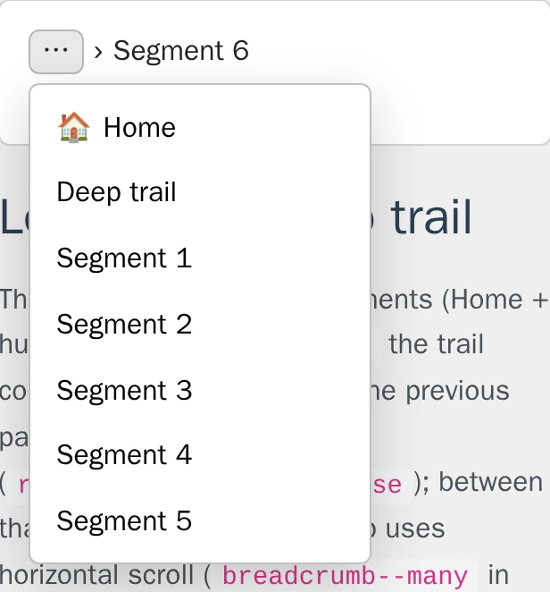

# Usage

## Table of contents

- [Twig functions](#twig-functions)
- [Presentation (home icon, hide on home)](#presentation-home-icon-hide-on-home)
- [Collapse on narrow screens](#collapse-on-narrow-screens)
- [Console commands](#console-commands)
- [Trail enrichers (events)](#trail-enrichers-events)
- [Overriding templates and translations](#overriding-templates-and-translations)
  - [Twig templates (REQ-TWIG-001)](#twig-templates-req-twig-001)
  - [Overriding translations (REQ-I18N-001)](#overriding-translations-req-i18n-001)
- [Theme slots of the trail](#theme-slots-of-the-trail)
- [Customising the dashboard](#customising-the-dashboard)
- [Data model (summary)](#data-model-summary)
- [Caching](#caching)
- [Testing: breadcrumb coverage](#testing-breadcrumb-coverage)

## Twig functions

Render the default breadcrumb markup (uses the bundle template):

```twig
{{ breadcrumb_render() }}
{{ breadcrumb_render('admin') }}
{# Optional: custom template, then context key (same as loader): #}
{{ breadcrumb_render('default', '@NowoBreadcrumbKitBundle/breadcrumb.html.twig', '') }}
```

When `inline_edit` is configured, `breadcrumb_render()` passes `breadcrumb_inline_edit` (`show`, `iframe_url`, `modal_title`) into the template; override the bundle template if you need different UI.

Build a custom layout from resolved nodes:

```twig

    <a href="{{ node.url }}">{{ node.label }}</a>{{ node.label }}

```

Optional dashboard link in your admin shell:

```twig

<a href="{{ url }}">Breadcrumb Kit</a>
```

## Presentation (home icon, hide on home)

Global defaults live under `nowo_breadcrumb_kit.presentation` (see [CONFIGURATION.md](CONFIGURATION.md)):

| Option | Effect |
|--------|--------|
| `home_icon` | Fallback icon/HTML for the first crumb when the collection has no `homeIcon` (or when it fails the icon allowlist). |
| `home_icon_replaces_label` | When `true` (default), first crumb shows the icon only; `aria-label` keeps the text label. |
| `hide_when_single_root` | When `true`, no trail is rendered if the only matched crumb is the root and it is the current page. |

Per collection, set `homeIcon` in the dashboard (text, emoji, inline SVG or simple inline HTML such as `<i class="bi bi-house"></i>`; event handlers, scripts and external links are rejected) and optionally `hide_when_single_root` inside **Responsive (JSON)**:

```json
{ "hide_when_single_root": true, "breakpoint": "md" }
```

Collection `homeIcon` wins over `presentation.home_icon`. Override `@NowoBreadcrumbKitBundle/_breadcrumb_crumb.html.twig` in your app for custom first-crumb markup.

## Collapse on narrow screens

Since **2.6.0** (spec [`004-collapse-narrow`](../specs/004-collapse-narrow/spec.md)), long trails can collapse GitHub-style on phones: below a width breakpoint the trail shows a **"…"** button, one separator and the **current crumb** (one line, ellipsis). The "…" button opens a dropdown listing every previous crumb in order (same labels, icons and links; non-link crumbs as text). Above the breakpoint the trail is unchanged and the "…" item is hidden. It is **opt-in**: with the option off (default), or when the trail has fewer than `min_items` crumbs, the HTML is byte-identical to 2.5.0.



**Global** (`config/packages/nowo_breadcrumb_kit.yaml`):

```yaml
nowo_breadcrumb_kit:
    presentation:
        collapse:
            enabled: true      # or simply `collapse: true`
            min_items: 3       # crumbs, current included (>= 2)
            breakpoint: '40rem' # px / rem / em, or an integer (pixels)
```

**Per collection** — key `collapse` in the collection **Responsive (JSON)** (`responsiveConfig`), which wins over the global value:

```json
{ "collapse": true }
{ "collapse": false }
{ "collapse": { "enabled": true, "min_items": 4, "breakpoint": "48rem" } }
```

A boolean toggles the option and keeps the global `min_items` / `breakpoint`. In an object every key is optional and a missing key keeps the global value (so `{ "collapse": { "breakpoint": "48rem" } }` only changes the breakpoint). Invalid values in the database (a `min_items` below 2, a breakpoint such as `"50%"`) are ignored key by key; they never break rendering. The older `responsiveConfig.breakpoint` key (printed as `data-breadcrumb-breakpoint`) is unrelated and unchanged.

**Markup** (only when the trail collapses; every normal item stays in the DOM):

```html
<div class="breadcrumb-kit" data-breadcrumb-collapse="40rem">
  <nav class="…" aria-label="Breadcrumb">
    <ol class="breadcrumb-list">
      <li class="breadcrumb-item"><a href="/">Home</a></li>
      … previous items and separators …
      <li class="breadcrumb-item breadcrumb-collapse">
        <details class="breadcrumb-collapse__details" data-bk-collapse>
          <summary class="breadcrumb-collapse__toggle" aria-label="Show previous pages" title="Show previous pages"><span aria-hidden="true">…</span></summary>
          <ol class="breadcrumb-collapse__menu" role="list" aria-label="Previous pages">
            <li class="breadcrumb-collapse__entry"><a class="breadcrumb-collapse__link" href="/"><span class="breadcrumb-icon" aria-hidden="true">…</span><span class="breadcrumb-collapse__label">Home</span></a></li>
            <li class="breadcrumb-collapse__entry"><span class="breadcrumb-collapse__text"><span class="breadcrumb-collapse__label">Shop</span></span></li>
          </ol>
        </details>
      </li>
      <li class="breadcrumb-separator" aria-hidden="true">…</li>
      <li class="breadcrumb-item is-current"><span aria-current="page">Product</span></li>
    </ol>
  </nav>
  <style nonce="…">…</style>
  <script src="/bundles/nowobreadcrumbkit/js/breadcrumb-collapse.js" defer></script>
</div>
```

The "…" item takes the collection `classItem` plus `breadcrumb-collapse`. In the menu the first crumb shows the home icon **and** its label (the trail may show the icon only). Labels are escaped; icons are printed raw like in the trail.

**Styles and behaviour**

- A nonce-stamped `<style>` (request attribute `csp_nonce`, like the inline editor) makes `.breadcrumb-kit` a size container (`container: breadcrumb-kit / inline-size`) and applies `@container breadcrumb-kit (width < <breakpoint>)`; browsers without container queries use `@media not all and (min-width: <breakpoint>)`. Below the breakpoint the list is a single non-wrapping flex row with `overflow: visible` (so the dropdown is not clipped), the current crumb truncates with an ellipsis, and the dropdown opens under the "…" button. The open animation only runs with `prefers-reduced-motion: no-preference`.
- The size container is its own stacking context: while the dropdown is open the wrapper gets `position: relative; z-index: var(--breadcrumb-kit-collapse-z, 30)` (via `:has()`), so it stays above positioned content that follows the trail.
- Because the wrapper is an inline-size container, it must take its width from its parent (normal block flow). If you place the trail in a shrink-to-fit context (inline-block, a flex item without `flex: 1` / `width`), give `.breadcrumb-kit` a width.
- `js/breadcrumb-collapse.js` (external, `defer`, delegated listeners, no inline handlers): **Escape** closes the open menu and puts focus back on the "…" toggle, a click **outside** closes it, choosing a **link** closes it. Without JavaScript the native `<details>` / `<summary>` disclosure still works (keyboard: Tab to "…", Enter / Space to toggle). Run `assets:install` after upgrading.

**Theming tokens** (custom properties with fallbacks; set them on `:root`, the wrapper or any ancestor — defaults use system colours, so they follow `color-scheme` light / dark):

| Token | Default | Used for |
|-------|---------|----------|
| `--breadcrumb-kit-collapse-bg` | `Canvas` | Dropdown background |
| `--breadcrumb-kit-collapse-fg` | `CanvasText` | Dropdown text |
| `--breadcrumb-kit-collapse-border` | `color-mix(in srgb, currentColor 25%, transparent)` | Toggle + dropdown border |
| `--breadcrumb-kit-collapse-hover-bg` | `color-mix(in srgb, currentColor 10%, transparent)` | Toggle hover / open, entry hover / focus |
| `--breadcrumb-kit-collapse-toggle-bg` | `transparent` | Toggle background |
| `--breadcrumb-kit-collapse-toggle-fg` | `inherit` | Toggle text ("…") |
| `--breadcrumb-kit-collapse-link` | `inherit` | Link entries |
| `--breadcrumb-kit-collapse-link-hover` | `--breadcrumb-kit-collapse-link` | Link entries on hover / focus |
| `--breadcrumb-kit-collapse-muted` | `color-mix(in srgb, currentColor 65%, transparent)` | Non-link entries |
| `--breadcrumb-kit-collapse-focus` | `Highlight` | Focus ring |
| `--breadcrumb-kit-collapse-radius` | `0.375rem` | Toggle, dropdown and entry radius |
| `--breadcrumb-kit-collapse-shadow` | `0 10px 30px rgb(0 0 0 / 0.18)` | Dropdown shadow |
| `--breadcrumb-kit-collapse-z` | `30` | `z-index` of the `.breadcrumb-kit` wrapper while the dropdown is open (the size container is its own stacking context) |
| `--breadcrumb-kit-collapse-max-width` | `min(20rem, 90vw)` | Dropdown max width |

Host rules on links inside the trail (for example `.my-trail a { color: … }`) also reach the dropdown links, which is usually what you want.

**Template overrides.** If you override `breadcrumb.html.twig`, add the three hooks of the bundle template: `data-breadcrumb-collapse="{{ trail.collapse.breakpoint }}"` on the wrapper when `trail.collapsible`, `` right before the separator of the current crumb, and `` once inside the wrapper (the demo override shows all three). `trail.collapse` exposes `enabled`, `minItems` and `breakpoint`.

## Console commands

| Command | Purpose |
|---------|---------|
| `nowo_breadcrumb_kit:generate-migration` | Write a Doctrine migration for breadcrumb tables (`--update` for additive columns such as `path_pattern` / `match_attributes`). |
| `nowo_breadcrumb_kit:export` | Export collections to JSON (`--file`, optional `--code` / `--context-key`). |
| `nowo_breadcrumb_kit:import` | Import JSON (`--file`, `--strategy=skip_existing\|replace`). |
| `nowo_breadcrumb_kit:preview` | Resolve a trail for a synthetic request (`--collection`, `--path`, `--route`, `--route-params`, `--attributes`, `--locale`). |

```bash
php bin/console nowo_breadcrumb_kit:generate-migration --update
php bin/console nowo_breadcrumb_kit:preview --path=/shop/item --route='*' --attributes='{}'
```

## Trail enrichers (events)

After `BreadcrumbLoader` builds a view, it dispatches `Nowo\BreadcrumbKitBundle\Event\BreadcrumbTrailBuiltEvent`. Subscribers may call `setView()` to replace labels, URLs, or inject nodes.

```php
use Nowo\BreadcrumbKitBundle\Event\BreadcrumbTrailBuiltEvent;
use Symfony\Component\EventDispatcher\EventSubscriberInterface;

final class EnrichBreadcrumbsSubscriber implements EventSubscriberInterface
{
    public static function getSubscribedEvents(): array
    {
        return [BreadcrumbTrailBuiltEvent::class => 'onTrail'];
    }

    public function onTrail(BreadcrumbTrailBuiltEvent $event): void
    {
        // $event->getView() / $event->setView(...)
    }
}
```

## Overriding templates and translations

### Twig templates (REQ-TWIG-001)

**Registration:** `TwigPathsPass` calls **`prependPath()`** for **`templates/bundles/NowoBreadcrumbKitBundle/`** when that directory exists, then **`addPath()`** for the bundle’s **`src/Resources/views`**, so application files always win over vendor for `@NowoBreadcrumbKitBundle/...`. The native loader alias **`twig.loader.native`** is resolved (including chained aliases) before attaching method calls.

**Procedure**

1. In your application, create a file under **`templates/bundles/NowoBreadcrumbKitBundle/`** with the same **`<subpath>`** as in the bundle (see table below).
2. Copy or adapt markup from the bundle’s `src/Resources/views/<subpath>` as needed — or `` and redefine only the blocks you need (dashboard pages: prefer `web_ui.templates.<page>` and the UiKit data blocks, see [Customising the dashboard](#customising-the-dashboard)).
3. Clear the Symfony cache if templates are cached (`php bin/console cache:clear`).
4. Treat a full copy as a fork: Symfony resolves `@NowoBreadcrumbKitBundle/<subpath>` to your file from now on.

**Override vs upgrade (freeze rule).** An application file at the override path always wins and will not pick up vendor changes for that path until removed or merged. A full-file override is an escape hatch: that `<subpath>` stays frozen on every `composer update` while the rest of the bundle keeps upgrading.

Prefer the upgrade-safe path, lightest first:

- **No Twig fork** — collection classes (`classList`, `classItem`, `classSeparator`, `classCurrent`), the `presentation.*` options ([home icon, hide on home](#presentation-home-icon-hide-on-home), [collapse](#collapse-on-narrow-screens)), the UiKit [theme slots of the trail](#theme-slots-of-the-trail) and the [translations](#overriding-translations-req-i18n-001).
- **Dashboard** — the UiKit theme and scaffolds, or `web_ui.templates.<page>` pointing at a template that extends `@!NowoBreadcrumbKitBundle/dashboard/...` and redefines one data block ([Customising the dashboard](#customising-the-dashboard)); the vendor page keeps upgrading underneath.
- **Surgical override** — copy only the small partial you need (`_breadcrumb_crumb.html.twig` for the crumb markup, `_breadcrumb_collapse.html.twig` for the "…" menu) instead of `breadcrumb.html.twig`; only that partial is frozen.

**Recovering upstream after a freeze:** delete (or rename aside) the application override, clear the cache (`php bin/console cache:clear`), and re-apply only the customisation you still need. Diff your copy against the new vendor file under `vendor/nowo-tech/breadcrumb-kit-bundle/src/Resources/views/` before re-copying.

**Templates you can override**

| Subpath | Purpose |
|---------|---------|
| `breadcrumb.html.twig` | Default breadcrumb markup (and optional inline-edit UI). |
| `_breadcrumb_crumb.html.twig` | Single crumb (icon, link, current page). |
| `_breadcrumb_collapse.html.twig` | "…" item + previous pages menu ([collapse on narrow screens](#collapse-on-narrow-screens)). |
| `_breadcrumb_collapse_assets.html.twig` | Nonce-stamped styles + `js/breadcrumb-collapse.js` of the collapse mode. |
| `dashboard/collection/index.html.twig` | Collections list (UiKit `page/list`). |
| `dashboard/collection/form.html.twig` | Collection create / edit (`page/form`). |
| `dashboard/collection/delete.html.twig` | No-JS delete confirmation (`page/confirm`). |
| `dashboard/item/index.html.twig` | Items of a collection (`page/list`). |
| `dashboard/item/form.html.twig` | Item create / edit (`page/form`). |
| `dashboard/item/delete.html.twig` | No-JS delete confirmation (`page/confirm`). |
| `dashboard/import.html.twig` | JSON import page (`page/form`). |
| `dashboard/_collection_form_partial.html.twig`, `_item_form_partial.html.twig`, `_import_partial.html.twig` | Forms loaded into the UiKit dialogs. |
| `dashboard/_form_dialog.html.twig`, `_dashboard_scripts.html.twig`, `_legacy_layout.html.twig` | Empty form dialog, `js/dashboard.js` tag, deprecated 1.x layout bridge. |
| `Collector/breadcrumb.html.twig` | Web Profiler / toolbar panel. |
| `Collector/_icon.svg.twig` | Profiler icon fragment. |

**Dashboard look and feel (REQ-UI-003):** the pages extend the UiKit 2.1 scaffolds; theme them once in `nowo_ui_kit` (layouts, theme slots, tokens) — see [CONFIGURATION.md](CONFIGURATION.md#look-and-feel-uikit-page-contract) and [TEMPLATES.md](TEMPLATES.md).

**Dashboard forms (FormKit):** every dashboard form type is a [FormKitBundle](https://github.com/nowo-tech/FormKitBundle) Type (`#[FormKitConfig('breadcrumb_kit')]` + `FormOptionsTrait`), including the search and delete forms (`DashboardGetSearchType`, `DashboardPostDeleteType`) rendered by the UiKit filters region and the UiKit action / confirm partials. Register `NowoFormKitBundle`; optional host `nowo_form_kit` YAML — see [CONFIGURATION.md](CONFIGURATION.md).

### Overriding translations (REQ-I18N-001)

The bundle uses the translation domain **`NowoBreadcrumbKitBundle`** for dashboard UI, forms, and validation messages. Bundle files live at `src/Resources/translations/NowoBreadcrumbKitBundle.{locale}.yaml` (bundled locales: **en**, **es**, **de**, **fr**, **it**, **nl**, **pt**).

Keys are grouped under **`dashboard`** (panel labels, buttons, pagination), **`form`** (field labels and help), and **`flash`** (success/error messages). Dashboard templates use `` or explicit `|trans({}, 'NowoBreadcrumbKitBundle')`.

**Override bundle strings** — create or edit in your project:

`translations/NowoBreadcrumbKitBundle.{locale}.yaml`

Example (`translations/NowoBreadcrumbKitBundle.es.yaml`):

```yaml
dashboard:
  title: 'Migas de pan'
  new_collection: 'Nueva colección'
  search_placeholder: 'Buscar por código o nombre…'

form:
  breadcrumb_collection_type:
    code:
      label: 'Código de colección'
```

You only need the keys you want to change; missing keys fall back to the bundle defaults. After editing translations, clear the cache: `php bin/console cache:clear`.

**Runtime breadcrumb labels** on the public site come from **JSON translations on `BreadcrumbItem` entities** (configured via the dashboard or fixtures), not from these YAML files. YAML overrides affect the admin dashboard and form messages only.

## Theme slots of the trail

`breadcrumb_render()` (template `breadcrumb.html.twig`) is host chrome, not an admin page: it keeps its markup and
collection classes (`classList`, `classItem`, `classSeparator`, `classCurrent`) and, since 2.7, appends the host
classes and attributes of three [UiKit](https://github.com/nowo-tech/UiKitBundle) theme slots when `nowo_ui_kit.theme`
sets them:

| Slot | Element |
| --- | --- |
| `breadcrumbs` | the `<nav>` of the trail |
| `breadcrumb_link` | every crumb link (`_breadcrumb_crumb.html.twig`) |
| `breadcrumb_separator` | every separator `<li>` |

```yaml
nowo_ui_kit:
    theme:
        classes: { breadcrumbs: 'app-crumbs', breadcrumb_link: 'app-crumbs__link', breadcrumb_separator: 'app-crumbs__sep' }
        attributes: { breadcrumbs: { data-controller: crumbs } }
```

Only the host classes are added (no `nowo-ui-*` semantic or framework classes), so with no theme entry for these slots
the output is the 2.6 markup byte for byte. The UiKit page headers render this trail instead of
`PageHeader::breadcrumbs` while `nowo_ui_kit.breadcrumbs.breadcrumb_kit` is `true` (UiKit wraps it in a `<div>` with
the `breadcrumbs` slot; `nowo_ui_kit.breadcrumbs.collection` / `PageHeader::breadcrumbCollection` choose the
collection). Add trail items for your admin routes (the demo seeds them for the dashboard routes).

## Customising the dashboard

Since **2.7** the dashboard pages follow the UiKit page contract (REQ-UI-003): every page extends a UiKit scaffold and
fills data blocks only; the header, actions, filters, table, row actions, confirm dialogs, pagination, empty states and
flashes come from UiKit and its theme. Pick the lightest tool:

1. **UiKit theme, once for every bundle** — `nowo_ui_kit.theme.classes` / `attributes` / `partials` / `tokens`;
   exceptions for this bundle under `nowo_ui_kit.theme.bundles.NowoBreadcrumbKitBundle`.
2. **Scaffold overrides, once per view type** — `templates/bundles/NowoUiKitBundle/page/list.html.twig` re-skins every
   bundle list page.
3. **One page of this bundle** — `nowo_breadcrumb_kit.web_ui.templates.<page>` pointing at a template that extends
   `@!NowoBreadcrumbKitBundle/dashboard/...` and overrides a data block:

```twig
{# templates/admin/breadcrumb_items.html.twig — web_ui.templates.items_index #}

<p class="{{ nowo_ui_class('muted', page.bundle) }}">Items are matched by route name.</p>
```

Pages, view models, data blocks and dialogs: [TEMPLATES.md](TEMPLATES.md). The 1.x chrome hooks (`dashboard.classes`,
`dashboard.partials`, `bk_*` blocks, layout slots) are deprecated or removed: see
[UPGRADING.md](UPGRADING.md#template-contract).

## Data model (summary)

Breadcrumb definitions are stored with Doctrine (`BreadcrumbCollection`, `BreadcrumbItem`). Items reference a Symfony route name (or `*` when constrained by path/attributes), optional static route parameters, optional `pathPattern` (PCRE against the request path) and `matchAttributes` (JSON map of request attributes), optional `parent` for trail order (root → leaf), JSON translations per locale, and optional URL generation via `dynamicParamKeys`. See the bundle `README.md` for the conceptual model.

## Caching

When `cache.pool` points to a valid service and the pool exists in the container, `BreadcrumbLoader` caches serialized item lists per collection/context to reduce database reads. Set `pool` to `''` to disable that cache.

## Testing: breadcrumb coverage

`Nowo\BreadcrumbKitBundle\Testing\BreadcrumbRouteCoverageTrait` fails a test when a page route of the application has
no breadcrumb row, listing every missing route, and when a row names a route that does not exist or a parent that has
no row. It ships in the package (namespace `Nowo\BreadcrumbKitBundle\Testing`, normal autoload) and needs
`phpunit/phpunit` in the host's `require-dev`.

```php
<?php
// tests/Integration/BreadcrumbCoverageTest.php

declare(strict_types=1);

namespace App\Tests\Integration;

use Nowo\BreadcrumbKitBundle\Testing\BreadcrumbRouteCoverageTrait;
use Nowo\BreadcrumbKitBundle\Testing\NonPageRouteFilter;
use Symfony\Bundle\FrameworkBundle\Test\KernelTestCase;
use Symfony\Component\Routing\Route;

final class BreadcrumbCoverageTest extends KernelTestCase
{
    use BreadcrumbRouteCoverageTrait;

    public function testEveryPageHasABreadcrumb(): void
    {
        $this->assertEveryPageRouteHasBreadcrumb();
    }

    // Rows: a JSON / YAML fixture. Remove this method to read the bundle tables of the test database instead.
    protected function breadcrumbCoverageFixturePath(): ?string
    {
        return \dirname(__DIR__, 2).'/fixtures/breadcrumbs.json';
    }

    // Non-pages the default rules cannot see (controllers returning a plain Response, guest pages, fragments).
    protected function breadcrumbCoverageFilter(): NonPageRouteFilter
    {
        return new NonPageRouteFilter(
            ignoredRoutes: ['app_login', 'app_invitation_accept', 'legal_*', '*_fragment'],
            ignoredPaths: ['/api/*'],
            isNonPage: static fn (string $name, Route $route): bool => str_ends_with($name, '_panel'),
        );
    }
}
```

On failure the message lists the routes to add, one per line:

```text
2 page route(s) have no breadcrumb row. Add them to /app/fixtures/breadcrumbs.json, or mark them as non-pages (route option "breadcrumb: false", NonPageRouteFilter ignoredRoutes / ignoredPaths / isNonPage):
  - app_invoice_show GET /invoices/{id}
  - app_reports ANY /reports
```

**Rows.** `breadcrumbCoverageRows()` returns a map "route name => parent route name (null for a root)". By default it
reads `breadcrumbCoverageFixturePath()` with `BreadcrumbRows::fromFile()`, or, when the path is null, the bundle tables
through `doctrine.orm.entity_manager` with `BreadcrumbRows::fromEntityManager()` (limited to
`breadcrumbCoverageCollection()` when that returns a collection code). A fixture may be the export of the dashboard or
of `nowo_breadcrumb_kit:export` (nested `children`; one collection or `collections`), or a flat list of rows naming
their parent (`{"items": [{"route": "app_items", "parent": "app_home"}]}`), in JSON or YAML. Override
`breadcrumbCoverageRows()` for any other provider. `breadcrumbCoverageChecksRows()` returning false skips the row
checks. Rows whose route is `*` (path-pattern rows) are not checked against the router.

**Which routes are pages.** `NonPageRouteFilter` skips, without requesting anything:

| Rule | Examples |
|------|----------|
| No GET among the route methods | `POST`-only form handlers |
| Name starting with `_` or path starting with `/_` | profiler, `_wdt`, error previews |
| Route option `breadcrumb: false` | `#[Route('/healthz', options: ['breadcrumb' => false])]` |
| `_format` requirement, non-HTML `_format` default, `.{…}` in the path | `/feed.{_format}` |
| Path ending with a non-HTML extension (`NonPageRouteFilter::DEFAULT_EXTENSIONS`, or `nonPageExtensions`) | `/export.csv`, `/manifest.webmanifest` |
| Symfony `RedirectController` | YAML `redirect` / `urlRedirect` routes |
| Controller return type `JsonResponse`, `RedirectResponse`, `BinaryFileResponse`, `StreamedResponse` (or a subclass); off with `inspectControllerReturnTypes: false` | JSON endpoints, downloads, signed join links that redirect |
| `ignoredRoutes` / `ignoredPaths` (exact or `fnmatch()` patterns), `isNonPage` predicate | host list |

`$filter->nonPageReason($name, $route)` tells why a route is skipped. The static assertions
(`assertBreadcrumbCoverage()`, `assertBreadcrumbRowsAreConsistent()`, `missingBreadcrumbRoutes()`) take a
`RouteCollection` and a row map and work in any PHPUnit test.
